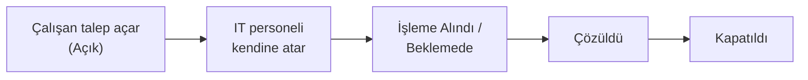
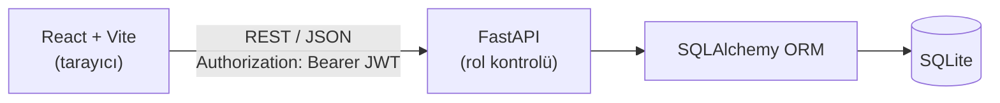
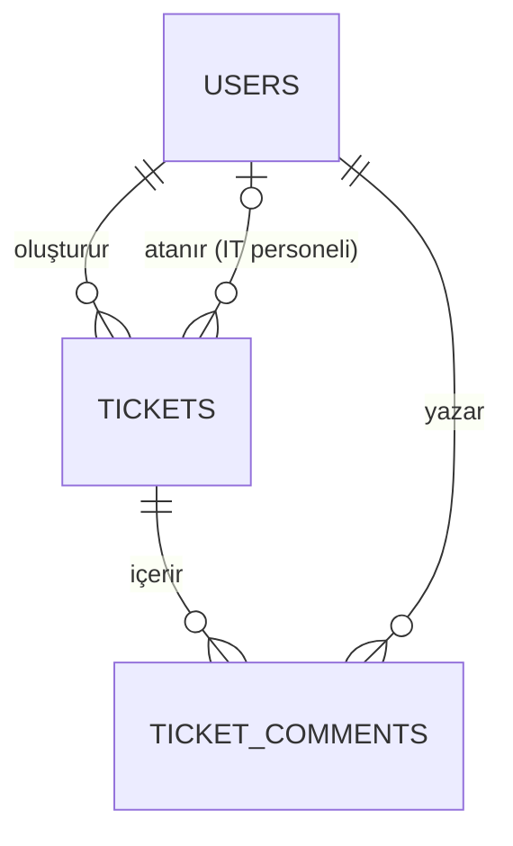

# IT Destek Talep Sistemi (Helpdesk)


Şirket içi IT destek süreçlerini dijitalleştiren, **rol bazlı** bir talep (ticket) yönetim sistemi. Çalışanlar yazılım, donanım ve ağ sorunlarını bildirir; IT personeli bu talepleri tek bir panelden yönetir. **FastAPI** ve **React** ile geliştirilmiş bir staj projesidir.

## İçindekiler

- [Özellikler](#özellikler)
- [Roller ve Yetkiler](#roller-ve-yetkiler)
- [Mimari](#mimari)
- [Veri Modeli](#veri-modeli)
- [API Özeti](#api-özeti)
- [Kurulum](#kurulum)
- [Testler](#testler)
- [Yol Haritası](#yol-haritası)

## Özellikler

**Çalışan**
- Kategori ve öncelik seçerek destek talebi oluşturma
- Yalnızca kendi taleplerini görüntüleme ve duruma göre filtreleme
- Talebe yorum ekleme, çözülen talebi kapatma

**IT personeli**
- Tüm talepleri listeleme, filtreleme ve arama
- Talebi kendine atama ve durumunu güncelleme
- İstatistik paneli: açık talep sayısı, kategori ve öncelik dağılımı (grafikler)

**Ortak**
- JWT ile kimlik doğrulama
- Talep başına yorum geçmişi (çalışan ve IT personeli arasındaki yazışma akışı)
- Rol kontrolleri yalnızca arayüzde değil, **API tarafında da** uygulanır: bir çalışan, doğrudan istek atarak dahi başkasının talebini göremez veya değiştiremez
- "İş emri fişi" temalı özgün arayüz: karbon kağıdı tonlu zemin, monospace talep numaraları, çözülen taleplerde damga rozeti

## Roller ve Yetkiler

| İşlem | Çalışan | IT Personeli |
|---|:---:|:---:|
| Talep oluşturma | ✅ | ✅ |
| Kendi taleplerini görme | ✅ | ✅ |
| Tüm talepleri görme | ❌ | ✅ |
| Talebi kendine atama / durum değiştirme | ❌ | ✅ |
| Talebi kapatma | Kendi talebini | Tüm talepleri |
| Talebe yorum ekleme | Kendi talebine | Tüm taleplere |
| İstatistik paneli | ❌ | ✅ |

**Tipik talep akışı**



## Mimari



```
backend/
├── main.py          # uygulama girişi, CORS, router kayıtları
├── init_db.py       # demo kullanıcıları ekler
├── auth/            # JWT, şifre hashleme, rol bağımlılıkları
├── models/          # User, Ticket, TicketComment
├── schemas/         # Pydantic şemaları
├── routers/         # auth, tickets, comments
└── tests/           # pytest testleri
frontend/
└── src/
    ├── pages/       # EmployeeDashboard, ITDashboard, TicketDetail ...
    ├── components/  # CreateTicketModal, StatsSection ...
    └── services/    # axios API istemcisi
docs/                # geliştirme notları
```

## Veri Modeli



| Tablo | Açıklama |
|---|---|
| `users` | Ad soyad, e-posta, hashlenmiş şifre, rol (`employee` / `it_staff`), departman |
| `tickets` | Başlık, açıklama, kategori, öncelik, durum, oluşturan, atanan IT personeli, tarihler |
| `ticket_comments` | Talep üzerindeki yazışmalar |

- **Kategori:** Donanım, Yazılım, Ağ/İnternet, Şifre Sıfırlama, Diğer
- **Öncelik:** Düşük, Orta, Yüksek, Acil
- **Durum:** Açık, İşleme Alındı, Beklemede, Çözüldü, Kapatıldı

## API Özeti

Backend çalışırken etkileşimli dokümantasyon: **http://localhost:8000/docs**

| Grup | Uç nokta | Yetki |
|---|---|---|
| Kimlik | `POST /auth/register` | Herkes |
| | `POST /auth/login` | Herkes (JWT döner) |
| | `GET /auth/me` | Giriş yapmış kullanıcı |
| | `POST /auth/refresh` | Giriş yapmış kullanıcı |
| Talep | `POST /tickets/` | Giriş yapmış kullanıcı |
| | `GET /tickets/` | Role göre filtrelenir (çalışan yalnızca kendi taleplerini görür) |
| | `GET /tickets/{id}` | Talep sahibi veya IT personeli |
| | `PATCH /tickets/{id}` | Yalnızca IT personeli |
| | `POST /tickets/{id}/assign-to-me` | Yalnızca IT personeli |
| | `POST /tickets/{id}/close` | Talep sahibi veya IT personeli |
| Yorum | `GET` `POST /tickets/{id}/comments` | Talep sahibi veya IT personeli |

## Kurulum

Gereksinimler: **Python 3.10+** ve **Node.js 18+**

### 1. Backend

```bash
cd backend
python -m venv venv

# Windows
venv\Scripts\activate
# macOS / Linux
source venv/bin/activate

pip install -r requirements.txt

cp .env.example .env        # SECRET_KEY değerini değiştirin
python init_db.py           # demo kullanıcıları ekler (tablolar uygulama açılırken zaten otomatik oluşur)
uvicorn main:app --reload --port 8000
```

### 2. Frontend

```bash
cd frontend
npm install
npm run dev
```

Uygulama: **http://localhost:5173**

> Windows'ta `start-backend.bat` ve `start-frontend.bat`, macOS / Linux'ta `start-backend.sh` ve `start-frontend.sh` dosyaları aynı adımları otomatikleştirir.

### Demo Hesapları (yalnızca geliştirme ortamı)

| Rol | E-posta | Şifre |
|---|---|---|
| IT Personeli | `admin@company.com` | `admin123` |
| Çalışan | `user@company.com` | `user123` |

## Testler

```bash
cd backend
pytest
```

24 test; kimlik doğrulama, rol bazlı yetkilendirme ve talep işlemlerini kapsar. Yetkilendirme testleri, bir çalışanın başkasının talebini görememesini ve IT personeline özel işlemleri yapamamasını doğrular.

## Yol Haritası

- [ ] Talebe dosya eki ekleme
- [ ] E-posta bildirimleri
- [ ] Talep çözüm süresi (SLA) takibi
- [ ] PostgreSQL desteği

## Lisans

MIT — ayrıntılar için [LICENSE](LICENSE) dosyasına bakın.

## Geliştirici

**Ayşe Gül Çelik**